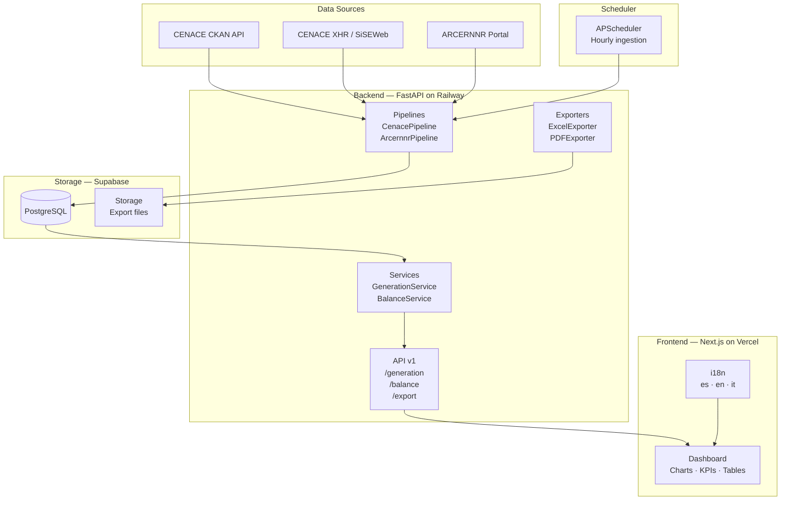

# Ennesso — Energy Data Governance Platform

> **ennesso.energy** — Energy data governance and balance for Ecuador's electricity system.

[](https://ennesso.energy)
[](https://railway.app)

---

## Overview

Ennesso ingests, normalises, and serves energy generation and dispatch data from
Ecuador's national grid operator (CENACE) and the regulatory body (ARCERNNR).
It exposes a clean API for the Next.js frontend, enabling real-time dashboards,
historical trend analysis, and structured data exports (CSV / XLSX / PDF).

---

## Architecture



---

## Monorepo Structure

```
ennesso/
├── frontend/          # Next.js 14 App Router + Tailwind + shadcn/ui
│   ├── app/
│   │   └── [locale]/  # next-intl locale routing (es, en, it)
│   ├── components/
│   ├── lib/
│   ├── messages/      # i18n JSON files
│   └── types/
├── backend/           # FastAPI + APScheduler
│   ├── app/
│   │   ├── api/v1/    # REST endpoints
│   │   ├── pipelines/ # Ingestion pipelines
│   │   ├── models/    # Pydantic schemas
│   │   ├── services/  # Business logic
│   │   ├── exporters/ # Excel / PDF generation
│   │   └── db/        # Supabase client
│   └── tests/
└── docs/
    └── decisions/     # Architecture Decision Records
```

---

## Getting Started

### Prerequisites

- Node.js 20+
- Python 3.12+
- Supabase project
- (Optional) Railway account for backend deployment

### Frontend

```bash
cd frontend
cp ../.env.example .env.local
npm install
npm run dev
```

### Backend

```bash
cd backend
cp ../.env.example .env
python -m venv .venv && source .venv/bin/activate
pip install -r requirements.txt
uvicorn app.main:app --reload
```

### Tests

```bash
cd backend
pytest
```

---

## Environment Variables

See [`.env.example`](.env.example) for full documentation of all required variables.

---

## Design Tokens

| Token       | Value     | Usage                        |
|-------------|-----------|------------------------------|
| Background  | `#0F1117` | Page background (dark-first) |
| Surface     | `#1A1D27` | Cards, panels                |
| Primary     | `#00C2A8` | Actions, highlights          |
| Thermal     | `#E05C2A` | Thermal generation           |
| Hydraulic   | `#2A7BE4` | Hydraulic generation         |
| Text        | `#E8EAF0` | Primary text                 |
| Muted       | `#6B7280` | Secondary text               |
| Border      | `#2A2D3A` | Dividers, input borders      |

Fonts: **IBM Plex Mono** (metrics/display) · **IBM Plex Sans** (body)

---

## Conventions

- **Language**: All code, comments, commits, and docs in **English**
- **TypeScript**: strict mode, `noUncheckedIndexedAccess`, no `any`
- **Python**: type hints everywhere, Pydantic models for all I/O
- **Commits**: [Conventional Commits](https://www.conventionalcommits.org/) — `feat(scope): description`
- **Catalog integrity**: Records are never deleted — only deactivated (`is_active = false`)

---

## Architecture Decision Records

| ID | Title |
|----|-------|
| [ADR-001](docs/decisions/ADR-001-monorepo.md) | Monorepo structure |
| [ADR-002](docs/decisions/ADR-002-fastapi.md) | FastAPI for backend |
| [ADR-003](docs/decisions/ADR-003-country-code.md) | `country_code` schema field |
